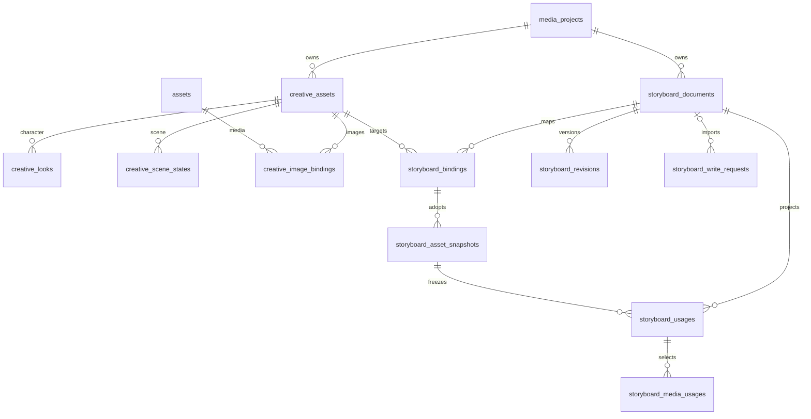

# 分镜 JSON 2.0 与项目资产关联规范

日期：2026-11-04。状态：设计规格，尚未实施。本文及同目录 Schema、合成示例是本次新增的设计产物；不表示现有导入器已支持、不授权数据库迁移、服务切换或修改导演 skill。

**本文已由用户最新确认的[简化方案](简化方案.md)取代。当前方向是完整JSON初始化/整体覆盖分镜、按名称复用资产、关联期间禁止删除、日常数据库编辑，不维护分镜历史或采用快照。本文及旧Schema、旧示例仅保留作设计讨论依据，不能直接作为本期开发输入；第15节也已被本次“允许完整重新初始化”的约定更新。**

## 1. 已确定的设计

1. 分镜必须属于素材管理器中的一个普通项目。无项目时不能新建、导入或编辑分镜；公共人物库不承载分镜。
2. 一个项目可以有多份分镜文档。项目 ID、分镜文档的数据库 ID、JSON 文档编号是三个不同概念。
3. 新 JSON 使用中文字段，格式标识为 `shiguang-storyboard`，格式版本为 `2.0.0`。
4. 人物、人物造型、场景、场景状态、道具在素材清单定义，镜头通过稳定编号使用它们。人物定义不再在顶层另存一份。
5. 人物、场景、道具继续复用 `creative_assets`；人物造型复用 `creative_looks`；图片继续复用 `assets` 和 `creative_image_bindings`。
6. 场景新增“参考状态”，表示同一空间的日夜、灯光或陈设版本。状态说明和本场人物调度分开保存。
7. 参考图需求可以没有真实图片。只有选中了素材库真实图片并核验内容后，才能创建图片绑定。
8. 分镜正文以数据库中的文档聚合记录为权威；资产关联和使用关系建立可查询的关系索引，与正文在同一数据库事务中更新。JSON 文件用于导入、导出和保留来源，不参与自动双写。
9. 每次使用资产明确记录采用快照，更新原档只提示，不自动改变既有使用及生成历史。
10. 公共人物、其他项目人物必须先复制为当前项目资产。JSON 中的数据库 ID 仅可作为来源线索，不能授权跨项目关联。
11. 当前 SQLite 或当前 MySQL 单库保存，不做 SQLite/MySQL 同步双写；MySQL 范围保持现有 8.2。
12. 本次规范覆盖数据交换、关系、数据库字段和迁移实施边界，不接入付费生成或携带媒体的资产包。
13. 用户追加确认：目标项目已经存在的人物直接复用，不自动重复建档。首次来源映射缺失时，按当前项目、资产类型及规范化的唯一名称精确查找；场景、道具采用相同查找规则。资料差异不改变默认复用决定，也不自动覆盖原档。
14. JSON只用于首次初始化，后续以数据库记录为唯一编辑依据；不要求用户或skill持续读取和修改外部JSON。

配套文件：`storyboard-v2.schema.json` 是结构约束；`最小示例.storyboard.json` 是全新合成示例，不来自用户剧本。跨对象引用、时间轴、项目归属等语义检查由本文规定，不能仅凭 Schema 通过认定业务有效。

## 2. 为什么采用文档聚合与关系索引

现有 `server/storyboard/shared/model.mjs`、React 编辑器均以整份项目对象执行编辑、撤销、重做和提示词快照。当前 `ProjectStore` 按文件整体保存，用文件哈希识别冲突，尚未与 `media_projects`、`creative_` 表关联。

新版将这份完整分镜正文存为数据库文档，同时将素材编号映射、资产采用快照、镜头使用和实际选图投影为关系表。反向查询通过索引查询，不搜索长文本，不将人物改名当作解除关联。

正文、映射和关系投影属于一次文档保存的共同结果；关系投影不能独立编辑。发现投影损坏时，先停止该文档写入，再依据文档与不可变快照校验重建，不从最新资产档案猜测旧镜头采用了什么。

## 3. 三类编号与版本

| 名称 | 格式与生成 | 用途 |
|---|---|---|
| 目标项目 ID | 当前 `media_projects.id`，UUID | 由页面选中并由服务器校验，JSON 不自动决定 |
| 数据库文档 ID | `storyboard_documents.id`，UUID | 服务内部定位、并发写入、版本历史 |
| JSON 文档编号 | UUID，首次创作保存生成 | 同一来源文档的持续更新、跨文件改名、重复导入 |
| JSON 节点编号 | ASCII，1—64 字符 | 文档内素材、造型、状态、场次、镜头、对白的永久身份 |
| 数据库资产/子项 ID | 现有 UUID | 当前项目的资产原档及其子项身份 |
| 采用快照编号 | JSON 为 ASCII 编号，库内为 UUID | 固定当次采用的文字、造型、图片职责与内容摘要 |

节点编号建议前缀：人物 `char_`、造型 `look_`、场景 `loc_`、场景状态 `state_`、道具 `prop_`、场次 `seq_`、镜头 `shot_`、对白 `dlg_`。前缀有助阅读，具体类型由所在结构确定。基础节点编号在同一文档中全局唯一；快照编号在快照集合内唯一，图片编号在所属快照内唯一。

排序、改名、修改内容均不换编号；复制镜头产生新的镜头和对白编号，并重映射其内部关系。复制整份分镜必须产生新文档编号；导出及重新导入同一份分镜保留文档编号。跨项目导入生成新的数据库文档、资产和子项 ID，JSON 来源编号可保留。

`格式版本` 描述协议；`内容修订` 为正整数，描述文档内容；数据库资产 `revision`、子项 `revision` 描述当前资产版本。三者不能混用。首次导入以输入内容修订初始化文档修订；本地保存递增；应用新版来源时采用 `max(本地修订+1, 输入修订)`。同内容无操作不递增。输入修订号不是覆盖许可，冲突仍比较内容与基线。

## 4. JSON 顶层

| 字段 | 类型 | 规则 |
|---|---|---|
| 格式 | string | 固定 `shiguang-storyboard` |
| 格式版本 | string | 固定 `2.0.0` |
| 文档编号 | UUID string | 必填，文件名变化不改变 |
| 内容修订 | integer | >=1 |
| 项目名称 | string | 分镜标题/来源项目名；不会自行创建或切换目标项目 |
| 版本说明 | string | 人可读的版本说明，可为空 |
| 类型、画幅、形式、故事核心、时间轴说明 | string | 保留导演创作信息；画幅如 `16:9` |
| 帧率 | integer | 1—240，默认新稿 30，继承已有项目时保留 |
| 目标时长秒 | number/null | 创作目标，可为空，不代替镜头实际总长 |
| 总时长秒、镜头总数 | number/integer | 由当前片段的镜头计算；输入时交叉校验 |
| 输出范围 | object | `类型` 为 `全片` 或 `片段`；含 `全片起始秒`，片段另含起始/结束镜号 |
| 素材清单 | object | 人物、场景、道具三个对象数组，可为空 |
| 全片设定 | object | 原有摄影、表演、光线、声音、服装等完整内容 |
| 场景 | array | 剧情场次数组，保留当前中文字段名，区别于素材清单中的场景资产 |
| 连续性与时长锁定 | object | 原有完整连续性要求 |
| 应用数据 | object，可选 | 应用导出的采用快照、生成历史、归档内容及来源信息；创作 skill 无需编造 |
| 扩展 | object，可选 | 其他创作信息；未知字段仍须原位保留 |

文件为 UTF-8 标准 JSON，无重复键、注释、NaN、无穷值或尾逗号。JSON 对象键顺序无业务意义；数组顺序有意义。空文本使用 `""`，没有选择使用 `null`，无条目使用 `[]`，不能用 `[待填写]` 代替数据。

解析前保留原始文本；整数须在 JavaScript 安全整数范围内，超界拒绝写入而不是先舍入。Schema的字符串长度按Unicode字符计数，当前资产服务另有UTF-16长度上限，导入语义校验须补核现有120/40等上限。复用现有受会话保护的100MB分镜请求上限，不为新版扩大；新稿不内嵌媒体字节。

未知字段须在原对象层级保留。未来主版本不明时保留原文件并拒绝自动写入；不能把未知协议强行当旧格式。所有文本均是数据，不执行其中命令或指令。

## 5. 素材清单：映射到当前资产库

### 5.1 统一字段

人物、场景、道具均有：`编号`、`名称`、`基础资料`、`需要参考图`、`参考图要求`、`限制要求`、可选 `扩展资料`、可选 `已归档`。

- 名称最多 120 字符，按现有 NFC + trim + lowercase 规则产生 `name_key`，唯一范围是项目与资产类型，包含归档记录。
- `基础资料` 是现有资产库可直接编辑的长文本权威字段。年龄、身份、外貌等完整写入此处；可选扩展资料可保存额外结构化数据，但不从长文本反向猜测并覆盖它。
- `需要参考图=false` 不妨碍建档，例如全片仅声音出场的人物。
- `参考图要求` 描述待制作内容，`限制要求` 描述必须锁定或禁止的事项；均不是生图任务，也不是图片绑定。
- 只有确实需要作为独立资产管理的关键道具列入清单。普通用品继续保留在分镜文字，不自动补建。不能按本示例固定素材数量。

### 5.2 人物与造型

人物增加 `性格与表演`、`默认造型编号`（可为 null）、`造型` 数组。

造型有：`编号`、`名称`、`说明`、`类型标签`（字符串数组）、`需要参考图`、`参考图要求`、`限制要求`、可选 `已归档`、`扩展资料`。

没有造型允许保存；有未归档造型时必须有且只有一个默认，且默认编号属于当前人物。仅声音人物可以没有造型。造型名称不等于镜头中的临时表情或姿态。

### 5.3 场景与状态

场景增加 `默认状态编号`（可为 null）、`状态` 数组。

状态有：`编号`、`名称`、`说明`、`需要参考图`、`参考图要求`、`限制要求`、可选 `已归档`、`扩展资料`。状态名称在同一场景内唯一，含归档记录。没有状态允许保存；有活动状态时必须明确默认。

场景基础资料保存固定门窗、出入口、结构和固定陈设；状态保存日夜、光线或陈设差异；剧情场次的空间设定保存当场人物位置、持物与调度。三类资料不可相互覆盖。

本次用户样例中的“玄关夜晚/清晨”“餐桌夜晚/清晨”，新版可各归入一个场景资产的两个状态，仍保留全部八个剧情场次。这是经导入预览确认的整理，不以字符串模糊相似自动合并。

### 5.4 道具

道具没有人物造型或场景状态层。固定外观、用途与限制写在资产资料中；由谁持有、在何处、打开/关闭等当镜状态写在镜头的道具使用关系中。不可分组合可以是一项，如蛋糕与纸托，不强行拆图。

### 5.5 现有字段精确映射

| JSON | 当前/新增数据库位置 |
|---|---|
| 人物/场景/道具名称 | `creative_assets.name`，同时计算 `name_key` |
| 三类资产分类 | `creative_assets.kind=character/scene/prop` |
| 所属项目 | `creative_assets.project_id`，服务器提供 |
| 基础资料 | `creative_assets.data_json.base_info` |
| 人物性格与表演 | `creative_assets.data_json.performance_info`；其他类型维持空文本 |
| 需要参考图/参考图要求/限制要求/扩展资料 | `creative_assets.data_json.details.reference_required/reference_brief/constraints/profile` |
| 默认造型编号 | 经映射转为 `creative_assets.default_look_id` |
| 造型名称/说明/类型标签 | `creative_looks.data_json.name/description/tags` |
| 造型参考图需求与限制 | 扩展 `creative_looks.data_json` 的 `reference_required/reference_brief/constraints/profile` |
| 默认场景状态编号 | 新增 `creative_assets.default_scene_state_id` |
| 场景状态 | 新表 `creative_scene_states` |
| 已归档 | 当前 `archived_at`，时间由系统产生，JSON 的 boolean 不冒充操作时间 |
| JSON 素材/子项编号 | 新表 `storyboard_bindings.source_id`，不直接写成当前资产 UUID |
| 复制来源 | 继续保留 `creative_assets/子项.source_json`；多文档导入来源放 `storyboard_bindings`，不覆盖原复制来源 |

现有 `ProjectAssets.write()` 对 JSON 内部字段有明确白名单；实现必须同时更新 normalize、读写、复制、版本快照、备份恢复，不能仅向输入对象塞字段后假称已经保存。

## 6. 剧情场次、镜头与对白

### 6.1 场次

沿用：`场次`、`地点`、`时间`、`内外景`、`空间设定`、`开始秒`、`结束秒`、`时长秒`、`镜头`。

新增 `编号`，作为永久身份；`场次`仅是显示编号。新增 `场景引用`，可为 null，或为：

| 字段 | 说明 |
|---|---|
| 场景编号 | 素材清单中的场景 ID |
| 状态编号 | 当前场景的状态 ID，可为 null |
| 采用快照编号 | 应用导出时可有，创作新稿省略或 null |
| 参考图编号 | 所选快照内图片编号数组；省略表示尚未明确选图 |

null 显示待关联，不擅自从“地点”文字猜测。导入已选场景但没选状态时，预览可提出采用其默认状态；用户确认后记录具体状态，日后不动态追随默认项变化。

### 6.2 镜头

沿用：`镜号`、`景别与角度`、`画面与人物动作`、`摄影机设计`、`声音与对白`、`开始秒`、`结束秒`、`时长秒`、`剪辑衔接`。

新增：

| 字段 | 类型/作用 |
|---|---|
| 编号 | 永久镜头 ID，排序不改变 |
| 出场人物 | 对象数组：人物编号、造型编号、出场方式、表演补充，可选采用快照编号、参考图编号 |
| 使用道具 | 对象数组：道具编号、使用人物编号、状态说明、位置说明，可选采用快照编号、参考图编号 |
| 场景覆盖 | null 或场景引用；null 表示沿用本场已确认的场景使用 |
| 首帧状态、物理反馈、环境反馈、段落结果、连续性、设计说明 | 可选长文本，映射现有 first_frame/physical_feedback/environment_feedback/result/continuity/design_note，不强填无关信息 |

人物出场方式枚举 `画内/画外/仅声音/待确认`。同镜同人物最多一条，同镜同道具最多一条。仅声音关联不自动使用人物参考图或要求造型。人物存在对白不等于画内。

`使用人物编号` 可为 null；有值时必须是当前镜头已列出的该人物，表示本镜实际使用者，不能把道具档案中的惯常主人当作本镜持有人。

场次引用是新镜头的默认选择。每个镜头实际采用的场景快照都要固定到其使用关系；修改场次引用时展示受影响镜头并明确应用。修改资产原档不会自行重算镜头有效场景。

为完整导出这种关系，系统维护 `应用数据.镜头场景采用` 数组，每项为 `镜头编号` 与 `场景引用`。当场景覆盖=null时，以此记录固定该镜头已经采用的场景；新创作没有此数组时，首次导入按场次引用解析并补齐。显式场景覆盖优先，不能同时保留一条相矛盾的应用记录。这样场次默认更新后，尚未选择同步的旧镜头仍可完整导出和重建。

### 6.3 对白与承接

`声音与对白` 包含 `环境与动作声`、`对白` 数组、`承接对白` 数组。

对白含：`编号`、`人物编号`、`声源`、`台词`、`表演要求`。一条对白只定义一次；同一说话人属于本镜出场人物，可标记画外或仅声音。无对白使用空数组。

承接含：`来源镜头编号`、`对白编号`、`说明`。来源必须更早、对白确属该来源镜头；同镜不能重复引用同一句。允许一次承接多句/多个声源。拖动后若来源不再早于承接镜，必须显示待修复并阻止错误生成，不能按新镜号误接另一句。

片段引用片段外对白时，`应用数据.外部对白` 提供来源镜头编号与完整对白定义；没有资料时明确报未解析关系。该来源只作承接依据，不把片段外镜头加入当前总时长，也不重复播放原句。

### 6.4 时间与排序

- JSON 保持数字秒，最多三位小数；数据库/内部模型使用精确整数毫秒。单镜 1—86400000 毫秒。用十进制解析校验，不能用二进制浮点近似判等。
- 数组顺序决定场次、镜头的排列；镜号/场次显示编号在保存时计算。新导入若显示编号和数组不一致，预览指出差异，不悄悄丢失原编号。
- 每镜时长是计算依据；起止时间、场次范围、镜头总数和总长是可校验的派生值。输入不一致时要求校正或明确选择时长依据。
- 全片从 0 开始；片段从输出范围的全片起始秒开始，总时长只计算该片段。淡出、转场等独占时间必须属于具体镜头，不能额外重复相加。

## 7. 已采用版本、真实图片与应用数据

### 7.1 采用快照

创作 skill 只提供文字和来源编号。首次导入关联资产后，系统固定当时采用的完整资产、子项与所选图片资料，产生不可变快照。镜头/场次通过 `采用快照编号` 使用它。

同一人物可在早期镜头采用旧快照，在新镜头采用新快照。不能只在人物映射上保存一个全局当前版本，否则更新会连带修改所有镜头。

应用导出将不可变快照加入 `应用数据.资产快照`：

| 字段 | 规则 |
|---|---|
| 编号 | 文档内快照来源 ID |
| 资产编号 | 对应素材清单的基础资产编号 |
| 资产修订号 | 来源资产 revision，可为 null；不能跨实例直接比较为最新版 |
| 来源实例编号、来源资产编号 | 可空的 UUID 来源线索，不作为目标绑定权限 |
| 子项修订号 | 造型/状态来源编号到 revision 的映射 |
| 资料 | 与该类素材定义相同的完整旧版资料，含其造型/状态及未知字段 |
| 图片绑定 | 当时可用的参考图片元数据及职责数组；不含图片字节 |
| 内容摘要 | 对除编号、内容摘要、来源实例编号、来源资产编号之外的快照对象规范化后做 SHA-256 |

规范化：递归对对象键按 UTF-16 码元字典序排序（与当前共享模型的 JavaScript `Object.keys(...).sort()` 一致），数组保序，字符串不自动 trim/改写；用 ECMAScript `JSON.stringify` 的字符串/有限数字表达序列化为紧凑 UTF-8 JSON，计算 SHA-256。所有跨语言工具必须匹配该共享算法，不自行舍入小数；源时间转换为精确整数毫秒。非 BMP 键、小数裁切参数和负零需有固定校验向量。

真实图片条目包含：编号、造型编号/null、场景状态编号/null、原图片绑定编号/null、媒体编号/null、原文件名、内容摘要、参考类型、用途说明、锁定内容、忽略内容、确认状态、裁切参数。媒体 UUID 只能在确认同一库来源后作为查找线索；换库时按用户明确选图重绑。哈希相同只提供候选，不自动继承标签、身份或绑定。

### 7.2 图片绑定规则

- 参考图要求没有图片文件时，只保存文字需求，不创建 `creative_image_bindings` 占位，不伪造 media ID 或 SHA-256。
- 同库选图复用现有媒体 ID，不复制原文件。新增图片先走现有目录登记、扫描和选图流程。
- 人物图属于某个造型；场景图可为通用图或属于某个场景状态；道具图直接属于道具。
- 没有显式选图时显示待绑定。导入预览可提出已核验的默认图，确认后将具体选择写入镜头，之后不动态替换。
- 封面裁切仅影响显示，生成使用原图。缩放、裁切参数不修改图片字节。
- 文件离线、缺失、注销、权限或内容改变分别显示状态。只保留图片元数据和预期哈希，不能承诺恢复旧原图。

### 7.3 应用数据兼容

应用数据还可包含 `镜头场景采用`、`历史素材清单`、`提示词批次`、`生成记录`、`归档镜头`、`原始导入`、`外部对白`、`本机线索` 和 `扩展`。当前英文标准 JSON 的 generation_batches/generation_runs、archived_shots、import_source 迁移时完整保留相应对象及未知字段；生成内容按原有状态和输入快照保存，导入不得启动、重发或轮询付费生成。

当前清单删除了某项但历史采用仍需要它时，导出将其必要定义放进 `历史素材清单`（与素材清单同结构），不偷偷加回当前清单或归档项目原档。历史定义仅供快照和历史镜头解析；新镜头必须选择当前清单中的活动资产。旧造型只存在于其采用快照时，可以建立 history_only 子项映射而不向现有原档补写旧造型。快照的资料定义是历史子项的完整解释依据。

导出时从不可变快照表补齐资产快照。数据库 `document_json` 保存其他完整文档内容和快照引用；快照正文单独存储一份，不在文档、各镜头和版本表反复嵌入。文档版本记录含快照 ID 集合，以保证历史可恢复导出。

## 8. 数据库表设计

以下为拟新增/调整字段，尚未执行 DDL。所有新增表均有 `created_at/updated_at`，UTC 毫秒安全整数；不可变表两者相等。UUID 在 MySQL 为 VARCHAR(36)，SQLite 为 TEXT；来源编号 VARCHAR(64) ASCII 二进制比较；哈希 CHAR(64) ASCII 二进制比较；时间/修订/排序 MySQL BIGINT、SQLite INTEGER；JSON 文本 MySQL LONGTEXT、SQLite TEXT。不要建立 LONGTEXT 唯一索引，也不依赖 MySQL JSON 专有查询。

### 8.1 复用现有表

- `media_projects`：保留现有普通/公共身份、名称与编号。未来项目删除须同时检查分镜文档，含归档文档。
- `creative_assets`：继续存人物/场景/道具。增加 nullable `default_scene_state_id`；data_json.details 采用第5节的字段。人物/道具该新列必须 null。
- `creative_looks`：保持人物专用，扩展 data_json 可保存参考图需求与限制；无需将场景状态伪装成人物造型。
- `creative_image_bindings`：增加 nullable `scene_state_id`；现有 `look_id` 保留。人物图 look_id 必填、scene_state_id=null；场景图 look_id=null、scene_state_id 可空；道具两者均 null。
- `creative_asset_versions`：保留资产整体不可变版本，新增状态与字段一并进入版本快照。
- `assets`：继续负责真实媒体的 ID、路径、状态、扫描与预览，不新增第二套媒体存储。
- `project_assets`：仍表示项目媒体采用记录，不复用为人物/分镜关联表，也不因分镜关联自动标记剪辑“已使用”。

### 8.2 creative_scene_states：场景状态

| 字段 | 类型 | 说明 |
|---|---|---|
| id | UUID PK | 永久状态 ID |
| asset_id | UUID NOT NULL | 所属 creative_assets，kind 必须 scene |
| name / name_key | VARCHAR(120) / 哈希 | 状态名及按现有规则计算的唯一键 |
| data_json | JSON文本 | description、reference_required、reference_brief、constraints、profile |
| default_image_id | UUID nullable | 本状态自己的默认图片绑定 |
| sort_order / revision | integer | 排序与子项修订 |
| archived_at | UTC毫秒 nullable | 归档保留 |
| source_json | JSON文本 | 来源追溯 |

唯一键 `(asset_id,name_key)`，索引 `(asset_id,sort_order,id)`。无活动状态时 default_scene_state_id=null；有状态时选明确默认。场景通用图片保留在 scene_state_id=null 的绑定中，不能被误计入每个状态的默认项。封面可显示通用图，但不代表镜头已经采用通用图。

### 8.3 storyboard_documents：项目内分镜文档

| 字段 | 类型 | 说明 |
|---|---|---|
| id | UUID PK | 数据库文档 ID |
| project_id | UUID NOT NULL | 普通项目；不可空 |
| source_document_id | UUID NOT NULL | JSON 文档编号 |
| schema_version | VARCHAR(16) | 2.0.0 |
| title | VARCHAR(120) | 分镜标题，来自项目名称 |
| revision | integer | 当前文档修订，用于 expected_revision CAS |
| last_source_revision | integer nullable | 最近成功来源修订，仅用于比较提示 |
| last_source_hash | 哈希 nullable | 最近成功导入的来源内容摘要，区别于含系统采用记录的content_hash |
| last_import_request_id | UUID nullable | 指向完整原始来源与导入决策，提供正文三方比较基线 |
| content_hash | 哈希 | 当前规范化文档与快照引用的摘要 |
| document_json | JSON文本 | 完整时间轴、正文、声明素材、生成历史、扩展；不重复存资产快照正文 |
| archived_at | UTC毫秒 nullable | 文档归档，不物理删除 |

唯一键 `(project_id,source_document_id)`；索引 `(project_id,archived_at,updated_at,id)`。文档标题无需全局唯一。镜头总数、总长通过文档计算，非第二个可编辑真相；列表缓存若增加必须在同事务中重算。

### 8.4 storyboard_bindings：文档来源编号映射

| 字段 | 类型 | 说明 |
|---|---|---|
| id | UUID PK | 映射 ID |
| document_id / project_id | UUID | 所属文档/项目，必须一致 |
| source_id | 来源编号 | JSON 素材或子项编号 |
| entity_kind | VARCHAR(16) | character/look/scene/scene_state/prop |
| match_method | VARCHAR(24) | source_mapping/exact_name/manual/created，记录匹配依据 |
| asset_id | UUID NOT NULL | 当前项目的顶层 creative_assets ID；子项也记录其所属资产 |
| look_id / scene_state_id | UUID nullable | 当前子项映射，仅对应类型可填 |
| parent_binding_id | UUID nullable | look 指向人物映射，scene_state 指向场景映射 |
| resolution | VARCHAR(16) | bound/history_only；后者只用于保留已有快照中的历史子项 |
| last_source_json / last_source_hash | JSON文本/哈希 | 最近成功输入的该节点资料，用于三方比较 |
| last_target_json / last_target_revision | JSON文本/integer nullable | 上次导入确认后目标实际保留的资料和修订，区别于选择不应用的源资料 |
| archived_at | UTC毫秒 nullable | 已退出当前清单的映射仍保留历史 |

唯一键 `(document_id,source_id)`；索引 `(asset_id,document_id)`、`(look_id)`、`(scene_state_id)`、`(parent_binding_id)`。活动顶层映射不能在同文档内用两个编号偷偷合并到同一资产；用户确认合并需统一所有引用后再保存。historical 子项在旧快照中存在、当前原档已无对应项时可保持目标子项 ID 为空，不能据此将历史文本写回原档。

新创作首次导入的活动子项必须 bound；不能用 history_only 绕过缺失引用检查。公共项目或其他项目 ID 一律不能直接填入 asset_id。

### 8.5 storyboard_asset_snapshots：不可变采用资料

| 字段 | 类型 | 说明 |
|---|---|---|
| id | UUID PK | 采用快照 ID |
| document_id / binding_id | UUID | 文档与顶层资产映射 |
| source_id | 来源编号 | 导出快照编号 |
| origin_instance_id / origin_asset_id | UUID nullable | 来源线索，不授权绑定 |
| origin_revision | integer nullable | 来源整体修订 |
| snapshot_hash | 哈希 | 规范化采用资料摘要 |
| snapshot_json | JSON文本 | 第7节完整资料、子项修订与图片元数据 |

唯一键 `(document_id,source_id)`；普通索引 `(document_id,binding_id,snapshot_hash)` 用于可选内容复用，同摘要不同来源编号不因此丢失身份。新版本创建新行，不能 UPDATE 内容；历史文档版本依赖的快照不清理。导入旧快照时重新验证资料和摘要，目标生成新内部 ID，不覆盖现有 creative_asset_versions，也不因不同库修订数字相同认定内容相同。

同一文档已有同编号快照而输入内容摘要不同，返回冲突，必须产生新快照编号；不能 UPDATE 旧行。来源元数据变化不能授权改写既有快照资料。

### 8.6 storyboard_usages：场次/镜头使用关系投影

| 字段 | 类型 | 说明 |
|---|---|---|
| id | UUID PK | 使用关系 ID；同一主体/角色保存时复用 |
| document_id / project_id | UUID | 归属 |
| owner_kind | VARCHAR(16) | scene/shot |
| owner_source_id | 来源编号 | 剧情场次或镜头永久编号 |
| usage_kind | VARCHAR(16) | character/scene/prop |
| binding_id / snapshot_id | UUID | 顶层资产映射与该次采用快照 |
| look_binding_id / state_binding_id | UUID nullable | 造型或场景状态映射 |
| holder_binding_id | UUID nullable | 道具使用人物的映射 |
| inherited_sequence_source_id | 来源编号 nullable | 镜头最初沿用的剧情场次；场次默认更新不会令历史关系悬空 |
| sort_order | integer | 本镜人物/道具排列 |
| data_json | JSON文本 | presence、performance、state_note、position_note及未知关系字段 |

唯一键 `(document_id,owner_kind,owner_source_id,usage_kind,binding_id)`；索引 `(binding_id,owner_kind)`、`(snapshot_id)`、`(look_binding_id)`、`(state_binding_id)`、`(holder_binding_id)`。每个 owner 最多一个 usage_kind=scene，须由服务校验并在数据库支持的约束中加固。没有镜头外键列，因为场次和镜头按来源编号存在 document_json 中；保存时必须验证其真实存在。

每个已有场景的镜头都物化一条有效场景关系，包括继承场次的镜头，使用查询与提示词不能在读取时临时解析最新场景默认项。人物/道具的归档不删关系；查询使用次数默认计有效镜头，场次默认关系不重复计数。

### 8.7 storyboard_media_usages：实际选图关系投影

| 字段 | 类型 | 说明 |
|---|---|---|
| id | UUID PK | 稳定选择 ID |
| usage_id | UUID | 当前使用关系 |
| image_source_id | 来源编号 | 所属采用快照内的图片编号 |
| image_binding_id | UUID nullable | 同库匹配到的现有图片绑定；历史或换库可为空 |
| media_asset_id | UUID nullable | 明确匹配到的真实媒体；未解析保持空 |
| expected_sha256 | 哈希 | 快照预期的真实图片内容摘要 |
| sort_order | integer | 本次选图顺序 |
| data_json | JSON文本 | 当次采用的用途、锁定、忽略、参考类型等覆盖；不修改原图 |

唯一键 `(usage_id,image_source_id)`；索引 `(media_asset_id,usage_id)`、`(image_binding_id)`。未解析图片保留名称、摘要与职责，不创建伪造 assets 行；显示待重绑/引用失效。正文的选图数组与此表须同事务一致。

所选图片必须存在于该使用的采用快照内：人物图属于本次选择的造型；场景图属于本次选择的状态或明确的通用场景图；道具图属于本道具。图片绑定已被后续原档修改时，读取旧采用职责及预期哈希，不能拿当前绑定的新版数据代替。

### 8.8 storyboard_revisions：文档版本

字段：`id UUID PK, document_id UUID, revision BIGINT, content_hash CHAR(64), document_json LONGTEXT, snapshot_ids_json LONGTEXT, operation_id UUID, summary TEXT, created_at BIGINT, updated_at BIGINT`。

唯一键 `(document_id,revision)` 和 `(document_id,operation_id)`。不可变。操作编号关联写请求回执表；相同operation_id携带不同正文拒绝。无变化保存返回当前版本，不新增文档版本，但写请求表仍保留准确的无变化回执。保存历史记录包括当时的来源映射说明、未知字段、生成历史与快照 ID 集合；历史恢复不得读取当前原档替换旧采用资料。撤销/重做提交为新的文档修订，不能把数据库 revision 倒退。

### 8.9 storyboard_write_requests：写入意图与结果（含导入）

字段：`id UUID PK, operation_kind VARCHAR(16), project_id UUID, document_id UUID nullable, source_document_id UUID, request_hash CHAR(64), content_hash CHAR(64), expected_revision BIGINT nullable, raw_json LONGTEXT, plan_json LONGTEXT, status VARCHAR(16), result_json LONGTEXT, error_json LONGTEXT, created_at BIGINT, updated_at BIGINT`。

operation_kind 为 import/save/adopt/restore/archive，所有分镜写入共用该回执契约。raw_json 保存该次输入，plan_json 保存导入决策或普通保存操作参数。无变化也有已提交回执。

状态 `prepared/committed/rejected`；“结果未知”是无法确定数据库状态时的展示，不凭网络异常写成 rejected。索引 `(project_id,source_document_id,created_at)`。同 request ID 的不同内容拒绝。

提交前先持久化 prepared 意图，业务事务中同时完成全部建档、文档、映射、快照、投影、版本及 committed 结果。意图记录与业务提交分两次事务，但人物/分镜等业务变更只有一次原子事务。明确回滚后才可另行记 rejected；提交回执不明先查询原请求。prepared 不代表失败，必须先核实在途与锁状态，不能创建另一请求猜测重试。

另设技术表 `storyboard_schema(id VARCHAR(64) PK,version BIGINT,created_at BIGINT,updated_at BIGINT)` 标记模块数据库结构版本；JSON格式版本、资产库creative_schema版本与此表分别管理。

### 8.10 关系图

图表示逻辑关系。现有表缺少统一物理外键，不能宣称已经由数据库保障跨项目/类型。实施采用项目锁、参数化写入、类型和归属校验为必需契约，新表之间可增加经SQLite/MySQL验证的 RESTRICT 外键。禁止 ON DELETE CASCADE 清除历史。新增外键前核对现有列类型/字符集/索引与存量一致性，不对作者库临时修表。MySQL DDL 与业务事务分离执行。

每次保存必须成立的关系不变量：

1. documents、bindings、usages记录的project_id相同，且项目为normal；引用资产也属于该项目。
2. character/scene/prop映射与creative_assets.kind相符；look和scene_state映射的parent_binding_id、asset_id及实际子项归属一致。
3. 每条usage的binding、snapshot、所选子项映射同属一份文档，snapshot绑定相同顶层资产；所选造型/状态必须真实存在于采用快照中。
4. 同镜道具持有人指向本镜人物关系；同镜对白说话人也必须在人物关系中，画外/仅声音仍是明确关系。
5. 选图编号属于本次快照并满足造型/状态范围；media_asset_id与expected_sha256来自核验结果，不能仅照抄外部UUID。
6. 普通保存不暗改资产原档；修改原档走明确的资产操作，再由文档显式采用。投影表只从已校验正文与快照生成。

## 9. 导入、重导入和冲突规则

### 9.1 导入预览

页面选目标普通项目，服务器校验；解析格式、编号、时间和引用；分别展示新增资产、关联已有、拟更新、历史资料、未绑定图片及重名。预览阶段不写业务资产，不扫描额外目录、不执行生成。

匹配顺序为：①该文档已有来源编号映射；②当前项目内同类型、按现有name_key规则精确同名的活动资产；③导入预览中的人工指定；④没有匹配才计划新建。已存在角色默认直接关联，不要求用户逐个重复确认，也不因为资料不同另建同名角色。场景、道具沿用相同顺序。

精确同名的范围限定为当前项目与同资产类型。其他项目或公共库同名不算目标项目已有；不能跨项目直接挂接。已有编号映射优先于同名查找：人物改名后重导入仍回到原ID，不能被后来创建的旧名字人物抢走映射。

归档同名资产显示待处理，允许明确恢复或改名，不自动恢复、不创建冲突副本。名称别称不自动视为同一身份，例如“陈母”和“奶奶”；用户可在预览中指定已有资产，确认后记住来源映射。禁止按包含关系、字符串相似或模型推断自动合并。

已有资产复用默认保留其原档资料；JSON相异字段作为差异展示，明确选择“应用这些资料到项目原档”才更新，提示影响同项目其他分镜。来源资料继续完整保留，但提示词和参考图采用该镜头已经选定的资产快照，不能混用JSON的旧造型与资产库新图片。

已有角色的造型、已有场景的状态只在该父项下匹配。新场景状态表有同父项名称唯一约束；现有人物造型名没有数据库唯一约束，因此精确同名有多条时必须选择，不能取第一条。造型/状态确实缺失时，在同一导入预览列为“复用原档并新增子项”，确认后更新该原档revision并建立子项，不另建人物或场景。选择保留原档且不新增所需子项时，该关系保留待选择，不能伪装关联完成。

输入已经明确引用、但仍未解决的造型/状态映射会阻止确认正式导入，保留原文件与预览草稿。用户明确清空该可选引用后可按待完善导入；不能由程序悄悄清空或换成另一默认项。没有图片本身不构成这种引用错误，文字资产照常可导入。

并发导入以项目锁和现有UNIQUE(project_id,kind,name_key)兜底。提交时重新校验预览匹配到的ID、名称与revision；预览后新增了同名资产时停止原计划并刷新为复用候选，不吞掉约束错误后继续写其他条目。

### 9.2 首次确认

1. 原始JSON和计划摘要进入固定请求意图。
2. 事务按“项目→文档→资产ID排序→请求”获取必要锁，并重新检查归属、名称、revision和请求摘要。
3. 通过资产模块共享的事务内写入方法创建/更新原档与子项，生成版本；不能先调用公开 create 建空档再逐个 save，不能在事务中 await 图片IO。
4. 建立来源映射。核验已选图片在事务外完成，事务内检查绑定/资产revision未变；文件可在之后变化，状态检查仍须保留。
5. 新增采用快照，规范化正文，计算完整使用与选图投影。
6. 同事务写文档、投影、文档版本和 committed 结果。任何一项失败回滚业务变更，不出现人物建成而分镜失败。

### 9.3 重导入

- 同项目、同文档编号定位原文档；先比较输入来源摘要与last_source_hash。输入和上次完全相同则返回无源变化，保留全部本地修改，不重复建档或递增revision。来源摘要比较不混入系统后来生成的快照编号、采用记录与本机线索；文档content_hash则涵盖这些实际内容。
- 内容有变，比较“最近成功导入基线、当前本地内容、新输入”。本地和输入都改了同一字段时必须选择；不能仅按内容修订号覆盖。
- 已有素材编号仍映射原资产；仅改名称不会新增资产。编号类型或父项变化显示冲突，不偷换人物身份或跨造型移动图片。
- 新增素材编号产生新增预览；清单少了某项不自动归档项目原档，只更新当前文档使用，映射和历史继续保留。
- 其他分镜使用同一项目资产时，其采用快照保持原样。新原档revision提示可更新，不跨文档自动采用。
- 导入较旧内容允许预览为另存或显式恢复，不能自动按大revision断定合法。
- 换项目使用独立映射与数据库ID。完整内部数据库备份恢复的“保留原ID”规则不用于一般JSON导入。

### 9.4 关系变化与旧快照

当前资产整体revision变化可显示“资料已更新”；同时对采用的造型/状态/图片子项及摘要判断实际差异，区分仅排序变化和所用内容变化。同库来源可靠时比较revision；跨库历史来源只显示“历史导入版本/待核对”，不能机械比较不同实例的修订数字。

用户采用新版时产生新快照并更新明确选中的使用关系；已有提示词批次以输入摘要标记需同步，原提示词和生成输入快照不改。归档资产/造型/状态/图绑定后，新镜头默认不可选；旧镜头保留历史依据并提示归档。

## 10. API 与前端接入设计

沿用 `/api/storyboard` 同源模块、原session/Host/Origin/token保护和服务关闭等待机制。拟新增接口：

| 接口 | 用途 |
|---|---|
| GET /documents?project_id=... | 仅列目标项目分镜 |
| GET /documents/:id | 正文、revision、映射、采用状态；校验项目上下文 |
| PUT /documents/:id | 整份保存；expected_revision + 固定 request_id；事务更新正文与投影 |
| POST /imports/preview | 解析原始JSON并生成绑定/重名/更新计划 |
| POST /imports/commit | 固定request_id + 计划摘要 + 目标revision，确认实施 |
| GET /imports/:request_id | 查询准确导入结果，防止超时重复创建 |
| GET /documents/:id/export | 规范化JSON，补齐采用快照和未知字段 |
| GET /documents/:id/revisions | 文档版本列表/详情 |
| POST /documents/:id/adopt-assets | 明确采用选中使用关系的新版资料 |
| GET /assets/:id/usage | 资产在哪些分镜/镜头中使用；按永久镜头ID定位 |

普通保存与导入共用storyboard_write_requests的request_id及回执，文档修订以operation_id关联它。查询普通写请求使用GET /requests/:request_id；导入查询接口为仅允许operation_kind=import的别名。未确认保存时保留本地输入，409 展示差异，不能自动用新revision重发旧正文。

页面共享顶部项目选择器，普通项目与资产库/音乐音效保持一致；没有项目显示选择/新建入口。切换项目前处理未保存草稿。草稿键包含实例、项目、文档ID；刷新恢复到对应hash和项目后再载入，不得把旧项目草稿写到新项目。

现有分镜“人物管理”入口转为当前项目资产选择/查看；编辑项目原档明确影响范围，镜头的临时表演说明单独保存。公共人物先经现有复制预览进入目标项目。撤销/重做只撤文档内编辑，不暗中撤销其他分镜可能使用的资产原档修改。

## 11. 旧数据与skill切换

支持三种输入适配器：现有中文结构、英文标准schema_version=1.0.0、本规范2.0.0。输出统一2.0.0；不靠“有schema_version就当英文旧格式”判断新协议。

旧中文：原始人物年龄/身份完整写入新基础资料，人物特点写入性格与表演；原人物对象同时保留来源。场次、动作、摄影机、对白、声音、连续性全文保留。现有字符串素材清单用于建档预览；没有可靠显式关系就待确认，不能按数组位置或模糊地点把场景自动绑定。旧中文缺文档编号时首次迁移分配并保存后续映射；按原文件摘要提供重复候选，不以文件名认定唯一。

旧英文：旧project_id仅是分镜工程编号，保存在来源；不得当media_projects.id。人物/镜头/对白等已有永久ID优先保留为来源编号；超过新字段长度或不合字符集时分配新来源编号并保留明确旧→新映射，不截断碰撞。旧素材embedded_data及相对路径在隔离预检后供用户确认入库；无文件则保留引用失效，不丢掉内嵌内容。旧生成快照/历史/未知字段完整保留。

旧内嵌媒体需要落盘或登记新目录时，作为明确的素材入库步骤单独完成，再启动分镜的数据库关联导入；分镜导入事务自身不写媒体文件。分镜失败时保留已入库媒体并报告尚未使用，不自动删除文件。原始导入中的内嵌数据在尚未完成迁移前完整保留，不能在JSON适配时丢弃。

旧文件迁移前备份、文件哈希校验与预览；未选目标项目的旧分镜仅进入“待归属迁移”只读入口，可备份导出，不能作为新正式分镜编辑。迁移成功之前不停止旧读路径；新库写入核对后才将该文档标记已迁移，原目录与快照不删除，不能同时后台向旧文件保存。

skill切换：先支持新版导入/导出和校验，再升级SKILL.md、references/storyboard-json.md及save_storyboard.py。skill负责导演创作、资料定义和关系；保存工具只补首次缺失编号、核算时间和校验，不猜剧情关系。已有节点禁止重新编号；新镜头/人物才分配编号。新稿使用2.0.0，修改旧项目按显式迁移流程，不擅自改用户Schema。

## 12. 数据库迁移与验收要求

1. 先实现可恢复的版本化迁移、备份和schema检查。当前资产库固定schema=1且恢复器核验精确表列；新增状态需要creative_schema升级为2、内部备份格式升级为2，并保留旧备份读取适配。不能直接添加列后让旧恢复器校验失败。
2. 迁移现有图片的scene_state_id为null，资产default_scene_state_id为null；不凭名称拆分或合并原场景。旧资产created_at/updated_at和原ID保留，新增时间由系统生成。
3. 更新MySQL表白名单、columnType、索引、迁移顺序、备份恢复；新增表和JSON字段一并覆盖。只用SQLite mock不能宣称MySQL通过。
4. 迁移失败不继续写业务；MySQLDDL不能依赖事务回滚，记录执行阶段并提供恢复入口。不能静默切SQLite。
5. 使用全新合成SQLite库与当前MySQL8.2隔离场，覆盖：首次全量建档、无图建档、重复导入、重名、跨项目拒绝、公共复制、场景两状态、每镜造型、对白承接、三方冲突、原档更新不改旧镜头、归档关系、引用失效、未知字段、导出重导入、事务中途失败和提交结果未知。
6. 定向浏览器验收覆盖：无项目入口、项目切换草稿、资产选择、选图、长文本、拖动/撤销后关系稳定、版本更新提示、刷新恢复、历史提示词不变。不得用作者库/素材或付费生成做测试。
7. 现有素材查找、项目媒体使用、提示词模板、Codex对话、目录扫描与MySQL身份不在本次重构写集；不得因新分镜导入重启MySQL或重新扫描未授权目录。

## 13. 本次设计交付与未实施事项

本次只增加本目录设计文档、Schema、合成示例及校对记录；没有修改业务源码、skill、用户分镜、数据库、配置、依赖、服务或构建产物。

设计自检结果见 `校对结果.json`：16项检查，其中10项故意构造的无效输入被正确拒绝；核对Schema内部引用、合成示例的结构/时间/关联、未知字段往返及共享规范化校验向量。结构检查使用覆盖本Schema所用约束的轻量子集检查器；未运行完整JSON Schema元规范验证器，不等同于导入器、SQLite/MySQL迁移或浏览器功能验收。

实施可按三个功能批次推进：①资产状态/字段与双库迁移；②分镜数据库聚合、绑定与导入导出；③前端项目强绑定、版本采用、skill新版输出与端到端验收。每批都交付可验证的结果，只有完整闭环通过才能宣布分镜资产关联完成。

## 14. 复用已有资产的实施风险复核

用户最新要求按“导入JSON人物→项目人物、JSON场景→项目场景、JSON道具→项目道具”建立映射；不是额外创建一套分镜人物原档。以下风险需在开发中实际覆盖：

| 情况 | 必需处理 |
|---|---|
| 同名跨项目 | 只查当前项目；公共/其他项目按复制规则处理 |
| 同一身份使用别称 | 不模糊自动合并；预览人工指定并持久化来源映射 |
| 同名人物的资料不同 | 默认保留已有原档，展示差异；更新原档需要明确决定 |
| 已有造型同名多条 | 现有代码允许该情况，不能自动取第一条；显示选择 |
| 已有角色缺新造型/场景缺新状态 | 新增子项进入预览，不重复创建父资产；不虚假填入默认项 |
| 活动名称与归档名称冲突 | 提示恢复或改名，不创建同名副本、不暗中恢复 |
| 场景名字混有日夜或调度 | 明确基础空间与状态；不按括号剥离等启发式自动合并 |
| 一个道具名代表两件物理物品 | 需要独立区分时使用不同名称与编号，例如“陈川的手机”“林悦的手机”；纯粹同款不自动认定同物 |
| 拖动/复制/删除后对白或素材错绑 | 永久节点编号+全图校验；复制生成新镜头/对白ID，源引用明确重映射 |
| 文档和关系索引不同步 | 自动保存、导入、采用、恢复、撤销/重做都经过同一事务写入口，禁止直接单表改正文 |
| 结构迁移或MySQLDDL中途失败 | 先备份和记录schema阶段，未完成时不开放写入；不依靠DDL事务回滚 |
| 网络超时/并发双建 | 固定请求编号、准确提交回执、项目锁及唯一键；先查结果再决定后续动作 |

尚未实现这些行为；现有16项设计自检不包含真实导入复用、数据库并发或迁移验收。新增规则需在后续SQLite与当前MySQL隔离场中定向验收。

## 15. 最新工作流：首次JSON导入，之后仅数据库交互

用户明确：JSON只在创建项目时导入，后续通过网页操作数据库。前面的“skill每次读最新JSON保留编号”“外部JSON更新后的三方合并”“整份/片段重导入模式”均不是日常工作流程，不应据此增加用户负担或产品入口。

### 15.1 当前已经实现的存储事实

- 项目、人物、造型、场景、道具和图片绑定已经在当前SQLite或MySQL中保存。
- 当前分镜仍由 `server/storyboard/storage.mjs` 的ProjectStore保存到数据目录下 `storyboards/<旧分镜工程ID>/project.storyboard.json`，包含素材目录及磁盘历史快照。当前尚未完成分镜入库与资产关系打通。
- 本设计的storyboard_表和creative_scene_states仍是拟实施结构，不存在“已经按本设计完成建表和业务写入”的结论。

### 15.2 确定的新版数据流

选中或新建普通项目 → 选择JSON → 校验并预览资产匹配 → 确认 → 同一业务事务保存资产、分镜正文、编号映射、使用关系和初始版本 → 返回数据库文档ID。

之后页面通过数据库API读取文档、编辑镜头、选择项目人物/场景/道具、保存以及查看历史。原始文件只保留一次来源依据，不监听、不回写、不要求持续存在；导入成功后原JSON移走不影响项目编辑。真实图片文件仍按素材库路径规则管理，其移动/缺失与原导入JSON是否存在是两回事。

### 15.3 存储方式不变的部分

采用“数据库文档正文 + 数据库关系索引 + 数据库不可变快照”，不在这一澄清中自动改成每个镜头/对白独立SQL行：

| 数据 | 保存位置 | 日常编辑 |
|---|---|---|
| 项目身份 | media_projects | 现有项目接口 |
| 人物、场景、道具原档 | creative_assets | 现有资产接口 |
| 人物造型、场景状态 | creative_looks / creative_scene_states | 对应资产子项接口 |
| 场次、镜头、对白、时长、运镜等完整正文 | storyboard_documents.document_json | 整份文档保存接口 |
| JSON编号到项目资产的首次对应 | storyboard_bindings | 首次导入建立，后续按已保存映射定位，不按名称重新猜测 |
| 镜头与人物/造型/场景/状态/道具的实际使用 | storyboard_usages | 文档保存时同事务投影 |
| 镜头选用的参考图片 | storyboard_media_usages | 文档保存时同事务投影 |
| 镜头采用的资料及图片职责 | storyboard_asset_snapshots | 新采用生成新快照，不改历史 |
| 文档版本 | storyboard_revisions | 实际变更保存时追加 |
| 首次导入原文与操作结果 | storyboard_write_requests | 原始文本只在import操作保留 |

document_json是数据库表中一个JSON文本字段，不是继续使用磁盘JSON文件。镜头/对白的永久ID也保存在数据库正文中，拖动排序不会改变ID；新建/复制由程序生成新ID，无需用户手动维护。关系表里的资产ID、绑定ID、快照ID为数据库UUID；来源编号仅作为首次解析、稳定节点身份和追溯依据，不承担外部同步义务。

普通保存仍须同事务更新正文、关系投影和历史版本，避免重复结构不一致。增加SQL关系表使反向使用查询无须扫描长文本；不因使用JSON文本正文就放弃项目归属或类型校验。

### 15.4 可移除的设计复杂度

- 不实现外部JSON重导入覆盖、片段合并与三方冲突比较；last_source_revision、last_source_hash、last_import_request_id及bindings的last_source/last_target系列字段无需作为持续合并状态保存，首次来源元数据集中保留在import请求与映射来源中即可。
- JSON文档编号与来源文件摘要只用于首次来源识别、避免同一次初始化重复落库和追溯，不要求skill为后续数据库编辑保留外部文件。
- 同一导入请求重复点击或超时仍必须幂等；数据库普通编辑仍要expected_revision，不能把“无外部JSON合并”误当成无并发冲突。
- 普通save/adopt/archive操作的raw_json可为空，仅存请求摘要、必要参数与回执；文档正文及版本表已经保存实际结果，不再复制完整输入正文。
- 导出JSON可作为可选的一次性输出，不参与日常保存和回写；一般文件导入不提供恢复现有文档的覆盖入口。内部数据库备份恢复继续采用独立流程。
- 同项目其他分镜更新了共用资产时，已采用版本提示仍保留；这是数据库资产变化，不依赖外部JSON。

本节仅纠正设计范围与存储说明；尚未迁移任何现有分镜或改写数据库。
